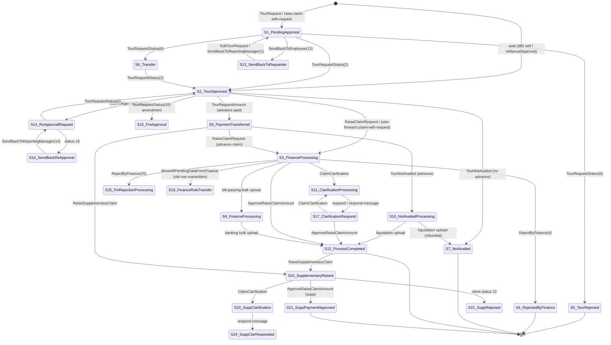

# Tour & Claim Lifecycle (state machine as implemented)

All `path:line` references are relative to `Tour_API/`. The repository abbreviations are the same as in `tour_claim_api_reference.md`:

| Abbreviation | File |
|---|---|
| EPR | EmpTourPlanRepository |
| CR | ClaimRepository |
| CER | ClaimEditRepository |
| CCR | ClaimClarificationRepository |
| TSR | TourStatusRepository |
| TLR | TourListingRepository |
| TNR | TourNotAvailedRepostitory |
| BAR | BulkApprovalRepository |
| TRR | TourRecoveryRepository |
| TOV | Helpers/Touroverlapvalidator |

All of these are under `TourProgram.BAL/Repository/Concrete/`, except TOV, which is `TourProgram.BAL/Helpers/Touroverlapvalidator.cs`.

---

## 1. Where state is stored

### `EMPClaimProcessDetail` (the status trail)

Defined at `TourProgram.DAL/Models/EMPClaimProcessDetail.cs:7-25`.

| Column | Meaning |
|---|---|
| `EmpTourId` | The tour (FK to EmpTourPlan) |
| `SenderId` | Employee who moved it |
| `RecipientId` | **The current holder** (whose queue the tour is in) |
| `ClaimTypeId` | The stage (FK to ClaimType) |
| `StatusId` | FK to `ClaimStatusCategory`, mapped at `TourProgramDbContext.cs:176-178` |
| `Remark` | Free text |
| `CreatedDate` | When the row was written |
| `IsActive` | Never cleared, so it carries no meaning |

How the trail behaves:
- **It is append-only.** The current status is the row with the **highest `Id`** for the tour. This is what listing, bulk, transfer and TOV use.
  - Two places order by `CreatedDate` instead: the edit guard (`EPR:1133-1137`) and the PreApproval guard (`TSR:246-248`).
- Two operations **overwrite** an older row instead of appending:
  - `MoveAllPendingDataFromFinance` rewrites the old row to 19 (`TSR:1199-1200`).
  - `TransferApproverPendingTasks` rewrites the old row to 26 (`TSR:1338+`).
  - `ClaimEdit/edit` rewrites the latest row's `RecipientId` (`CER:118-131`).

### `EmpTourPlan` (the tour and claim header)

Defined at `TourProgram.DAL/Models/EmpTourPlan.cs`. It holds flags and amounts, not the status:

| Purpose | Columns |
|---|---|
| Approval | `ApprovedBy`, `ApprovedDate` |
| Advance | `ApprovedAmount` |
| Claim amounts | `ClaimAmount`, `ClaimApprovedAmount`, `ClaimApprovedBy`, `ClaimApprovedDate` |
| Refund | `PaidAmount`, `PaymentReferenceNo` |
| Tour type and routing flags | `IsAdvanceRequired`, `IsClaimWithRequest`, `Jurisdiction`, `TourType`, `IsReApproval` |
| Cancellation | `IsCanceledWithAdvance`, `IsCanceledWithoutAdvance` |
| Supplementary | `IsSupplementaryRaised`, `SupplementaryRequestAmount`, `SupplementaryApprovedAmount` |
| SAP acceptance | `IsSapAdvanceApprovalAcepted`, `IsSapCliamApprovalAcepted`, `IsAdvanceAdjustmentAcepted`, `IsCreditCardClaimApprovalAccepted`, `IsSapSupplementaryAccepted` (all with dates) |
| Liquidation | `IsAdvanceLiquidated` |

### `FinanceDetail` (SAP and finance references)

Defined at `TourProgram.DAL/Models/FinanceDetail.cs`. It stores:
- the bill-passing, liquidation and payment-processing SAP references
- `ApprovedAmount`, `PaidAmount`, `UTRNO`
- the flags `IsLiquidation` and `IsLiquidationRequired`

### Other state

- **Recovery** is a separate machine in `TourRecovery.StatusId` (`TourProgram.DAL/Models/TourRecovery.cs:68`); see §8.
- **Drafts** are separate from the trail, in these tables:
  - `TourRequestDraft`
  - `ClaimDraft` (DraftType 1 is the legacy within-jurisdiction draft, 2 is outside-jurisdiction)
  - `ClaimWithRequestDraft`

  Each has `IsSubmitted` and `IsActive`. A draft never creates a status row until it is submitted.

## 2. Status IDs

The seeded `ClaimStatusCategory` rows are in `TourProgram.DAL/Migrations/TourProgramDbContextModelSnapshot.cs:878-1110`. The enum `RecordMasterClaimStatusCategory` is at `TourProgram.Utility/Eumus/RecordMasterEnum.cs:150-216`.

| Id | Seeded name | Enum member | Written by (path:line) |
|---|---|---|---|
| 1 | Pending for Approval | PendingApproval | Tour create `EPR:622-644`; tour edit `EPR:~1400`; SendBackToReportingManager (client value) `EPR:1912` |
| 2 | Tour Approved | Approved | `TSR:294-315` (client StatusId); auto/MD/manual approval `EPR:684-705` |
| 3 | Finance Processing | BillPassingProcessing | Outside-jurisdiction claim `CR:2082-2103`; auto-forward after approving a claim-with-request `TSR:340-381`, `EPR:~740-760` |
| 4 | Rejected By Finance | RejectedByFianance | RejectByFinance (client value) `TSR:571-597` |
| 5 | Tour Rejected | Rejected | TourRequestStatus (client value) |
| 6 | Tour Transfer | Transfer | TourRequestStatus (client value); grants the approver role `TSR:334-338` |
| 7 | Tour Not Availed | TourNotAvailed | Non-advance cancel `TNR:128-236`; bill-passing liquidation with refund `BAR:534-538` |
| 8 | Finance Processing | FinanceProcessing | Bill-passing bulk upload `BAR:523-533` |
| 9 | Payment Transferred | PaymentTransferred | Advance amount approval `TSR:122-159`; supplementary amount `TSR:83-106`; banking upload (advance, no claim) `BAR:666-704` |
| 10 | Tour Not Availed Processing | TourNotAvailedProcessing | Advance cancel `TNR:237-287` |
| 11 | Clarification Processing | ClarificationProcessing | Clarification raised `CCR:119-154` |
| 12 | Process Completed | ProcessCompleted | Finance claim approval `CR:3982-4018`; bulk liquidation `BAR:546-550`; banking upload `BAR:686-702` |
| 13 | Send Back To Requester | SendBackToRequester | SendBackToEmployee (client value) `EPR:1861`; or TourRequestStatus |
| 14 | Re Approval Request | ReApprovalRequest | `EPR` TourReApprovalRequest (≈`EPR:2083`) |
| 15 | Pre Approval Request | PreApprovalRequest | TourRequestStatus with amendment guards `TSR:204-262`; SendBackToEmployee comment "13,15" |
| 16 | Send Back To Approval Requester | SendBackToRequesterReApproval | Client value via TourRequestStatus or UpdateTourReApprovalStatus (no dedicated writer) |
| 17 | Clarification Respond | ClarificationResponsed | respond `CCR:2161-2182`; respond-message `CCR:1160-1199` |
| 18 | *(not seeded, not in the enum, never written)* | — | Only a wrong comment at `CGMExcessiveTourRepository.cs:67`. The frontend label "Pending with unit Finance" has no backend counterpart. |
| 19 | Finance Role Transfer | FinanceRoleUpdate | Overwrite in MoveAllPendingDataFromFinance `TSR:1199` |
| 20 | Supplementary Raised | SupplementaryRaised | `CR:7090-7104` |
| 21 | Supplementary Payment **Approved** (seed and enum; the frontend says "…Transferred") | SupplementaryPaymentApproved | `CR:3770-3785` |
| 22 | Tour Supplementary Rejected | SupplementaryRejected | Only via client value (RejectByFinance or TourRequestStatus); no dedicated writer |
| 23 | Supplementary Clarification Requested | SupplementaryClarification | `CCR:95-117` |
| 24 | Supplementary Clarification responded | SupplementaryClarificationResponded | respond-message only `CCR:1127-1158` |
| 25 | Finance Rejection Processing | RejectedByFiananceProcessing | Client value to RejectByFinance; the "must pass 25 first" guard is commented out `TSR:552-564` |
| 26 | Approver Role Transfer | ApproverRoleUpdate | Overwrite in TransferApproverPendingTasks `TSR:1338` |

Notes on the frontend and the enums:
- The frontend list matches the seeds for 1–17 and 19–21, except for the name of 21.
- The frontend list lacks 22–26.
- A second, older enum, `RecordMasterClaimStatus` (`RecordMasterEnum.cs:126-149`), is used in some comparisons. Its values agree with the seeds.

### ClaimTypeId (the stage), from `RecordMasterClaimTypes` (`RecordMasterEnum.cs:56-68`)

| Id | Meaning |
|---|---|
| 1 | TourRequestAdvance (tour with an advance) |
| 2 | TourRequestAdvanceClaim (claim on an advance tour) |
| 3 | TourRequestClaim |
| 4 | TourRequest |
| 5 | TourNotAvailedClaim (unused in scope) |
| 6 | AdvanceNotAvailed |
| 7 | Supplementary |

The usual derivation (for example `CCR:119-154`):
- `IsAdvanceRequired` true and `ClaimAmount` null → 1
- `IsAdvanceRequired` true and `ClaimAmount` set → 2
- `IsAdvanceRequired` false and `ClaimAmount` null → 4
- `IsAdvanceRequired` false and `ClaimAmount` set → 3
- If `IsSupplementaryRaised`, the type is 7 instead.

The same `StatusId` can mean different things depending on the ClaimType. For example, 9 with ClaimType 1 means the advance was paid; 9 with ClaimType 7 means the supplementary amount was approved.

---

## 3. Transitions

"Actor (as coded)" is who the frontend intends. **The server never checks it** (see §4).

### 3.1 Tour request and approval

| From | To | Endpoint | Actor | Guard (server-side) | Side effects |
|---|---|---|---|---|---|
| ∅ | **1** (ClaimType 1/4) → ManagerId | POST TourPlan/TourRequest; SubmitTourRequestDraft | Employee | DailyTourDateValidation required for Daily or claim-with-request; no date overlap (TOV, under lock) (`EPR:332-361`) | Request PDF; approver role granted to the manager |
| ∅ | 1 → **2** "Auto Approval" (→ **3** to finance if claim-with-request) | Same call, when `EmpId==ManagerId` or `IsManualApproval` | Employee (MD / manual approval) | None beyond the above (`EPR:650-791`) | Approval PDF; ApprovedBy/ApprovedDate set |
| any | **2** Approved | PUT TourStatus/Update/TourRequestStatus (StatusId=2) | Approver | Duplicate tuple only | ApprovedBy/ApprovedDate set; approval PDF (re-approval merge if IsReApproval) |
| 2 (claim-with-request) | **3** → unit finance user (ClaimType 3, or 2 with advance) | Automatic inside the call above | System | Finance lookup via Org API; failure is swallowed with "Warning:" (`TSR:340-381`) | Finance role granted |
| any | **5** Rejected | TourRequestStatus (StatusId=5) | Approver | The "can't reject after approve" guard is dead code (`TSR:279-287`) | **ApprovedBy is set to the rejecter and the approval PDF is regenerated** |
| any | **6** Transfer → new approver | TourRequestStatus (6) | Approver | Duplicate tuple | Role granted to the new recipient |
| any | **13** Send back → employee | POST TourPlan/SendBackToEmployee/{tour}/{sender}/13, or TourRequestStatus(13) | Approver | None (`EPR:1861-1910`) | — |
| 13 / 16 | **1** (or 14) → manager | PUT TourPlan/EditTourRequest (writes 1); POST SendBackToReportingManager/{tour}/{mgr}/{1\|14} | Employee | Edit: latest status ≠ 2, no overlap (`EPR:1133-1172`). SendBack: none | Edit regenerates the request PDF |
| any (intended: 2) | **14** Re-approval → manager | POST TourPlan/TourReApprovalRequest/{tour} | Employee | Overlap only; **no check that the tour is approved** | Old header, itinerary and approver snapshotted; `IsReApproval=true`; `ApprovalPDFPath` cleared |
| 14 | **2** / **16** / 5 | TourRequestStatus or UpdateTourReApprovalStatus | Approver | Duplicate tuple (exempted when IsReApproval) | TourRequestStatus merges the re-approval PDF; UpdateTourReApprovalStatus writes the row only |
| any | **15** Pre-approval (amendment) | TourRequestStatus (15); SendBackToEmployee (15) | Approver | Only on TourRequestStatus: not 5, not 7, no claim in 3/8/12, latest ClaimType = 4 (`TSR:204-262`) | — |

### 3.2 Advance (tours with `IsAdvanceRequired`)

| From | To | Endpoint | Actor | Guard | Side effects |
|---|---|---|---|---|---|
| any (intended: 2 with ClaimType 1) | **9** → employee (ClaimType 1) | PUT TourStatus/Update/TourRequestAmount | Finance | Same amount already in FinanceDetail → 400 | `EmpTourPlan.ApprovedAmount` and a FinanceDetail row (`TSR:122-159`) |
| FinanceDetail without SAP reference | **8** → `recipientId` (banking) | POST BulkApproval/UploadBillPassingBulkApproval | Finance (bill passing) | None | SAP payment-approval reference |
| 8 | **9** (advance, no claim yet) / **12** | POST BulkApproval/UploadBankingBulkApproval | Banking | None | `PaidAmount`, `PreAdvanceUTRNo` (`BAR:616-742`) |

Bill passing can also run as a liquidation. In that case `UploadBillPassingBulkApproval` writes **7** (the employee refunded and no liquidation is required) or **12** (liquidation is required) to the employee (`BAR:534-550`).

### 3.3 Tour not availed (cancel)

| From | To | Endpoint | Guard | Side effects |
|---|---|---|---|---|
| any | **7** (self → self, ClaimType 4) | POST TourNotAvailed/{tour}/{recipient} on a non-advance tour | None | `IsCanceledWithoutAdvance`; the email is commented out |
| any | **10** → finance (ClaimType 6) | Same endpoint, advance tour with `ApprovedAmount ≠ 0` | Advance amount must be approved; otherwise 400 | `IsCanceledWithAdvance` |
| (no status change) | — | POST TourNotAvailed/PaymentRefund/... | None | `PaidAmount` and `PaymentReferenceNo` set; refund proof stored as upload type 6 |
| 10 | **7** or **12** | Bill-passing liquidation upload | None | Liquidation flags |

TOV treats tours whose latest status is 4, 5 or 7 as inactive (`TOV:278-294`). A tour sitting in status 10 therefore still blocks date overlaps.

### 3.4 Claim raise (draft → submitted)

| From | To | Endpoint | Guard | Side effects |
|---|---|---|---|---|
| (draft) | (draft) | Save*Draft | Draft ownership (body EmpId); no business validation | Files kept in `wwwroot/temp-uploads` |
| **Outside jurisdiction**: any (intended: 2) | **3** → client-chosen finance `RecipentId` (ClaimType 2 or 3) | POST Claim/RaiseClaimRequest; SubmitRaiseClaimDraft | 30 s trail / 5 min transport duplicate windows; ClaimTourDetails must exist; cancellation claim with DA → 400; DA overlap → 409 (`CR:1558-2182`) | Rows and files saved; draft consumed; advance refund recorded if `PaymentReferenceNo` given |
| **Within jurisdiction**: ∅ | **1** → manager, then on approval **2 → 3** automatically | POST Claim/raise-claim-with-request; SubmitClaimWithRequestDraft | DA JSON pre-check, DailyTourDateValidation, date overlap, DA post-check (`CR:2811-2872`) | Tour and claim created in **two** transactions; a failed claim step leaves a status-1 tour behind |

### 3.5 Finance, bill passing, clarification, payment

| From | To | Endpoint | Actor | Guard | Side effects |
|---|---|---|---|---|---|
| any (intended: 3/17) | **11** → body `ReciverId` (the employee) | POST ClaimClarification | Finance | None | Question row |
| any (intended: 11) | **17** → body `RecipientId` (the asker) | POST ClaimClarification/respond (with data) or /respond-message (text only) | Employee | The question row must exist; repeated answers allowed | `respond`: history snapshot, rows re-synced, `ClaimAmount` overwritten |
| any (intended: 3/17) | **12** → employee | PUT Claim/ApproveRaiseClaimAmount/... | Finance | amount ≤ ClaimAmount; sum of the rows sent matches (`CR:3805-3926`) | `ClaimApprovedAmount` set, FinanceDetail row, merged PDF; the tour becomes eligible for the SAP pull |
| any (intended: 3/17) | **4** (or **25**) → client recipient | PUT TourStatus/Update/RejectByFinance | Finance | Advance tour whose latest ClaimType is 2 → 400; duplicate tuple | — |
| 3 / 17 / 24 (old finance user) | same status → new finance user; old row overwritten to **19** | PUT TourStatus/Update/MoveAllPendingDataFromFinance | Any authenticated user | Input checks only | History rewritten |
| 12 | (no status change) | SAP GetSapDetails / UpdateSapDetails | SAP (API key) | RFNO prefix A/C/S/D/R | Sets `IsSap*Acepted` flags only. **Never writes 9 or 12.** |

Approver-side "pending for approval" counts and queues use statuses 1, 6 and 14. Finance bill-passing queues use 3, 17 and 25 (`TLR:2515-2637`).

**Outcome to expect:**
- A non-advance claim normally ends at **12** directly from `ApproveRaiseClaimAmount`.
- **9** usually means an advance (or supplementary amount) was paid or approved. It is not the end of the claim.

### 3.6 Supplementary claim

| From | To | Endpoint | Guard | Side effects |
|---|---|---|---|---|
| **12 or 9** (latest by CreatedDate) | **20** → unit finance user (ClaimType 7) | POST Claim/RaiseSupplementaryClaim | Owner `EmpId`; only one supplementary per tour; 30 s window; finance user must be found; DA overlap | `IsSupplementaryRaised` and amounts set |
| any (intended: 20) | **23** → employee | POST ClaimClarification (when `IsSupplementaryRaised`) | None | — |
| 23 | **24** (respond-message) / **17** (respond, a bug) | Clarification respond endpoints | None | — |
| any (intended: 20/24) | **21** → employee | PUT Claim/ApproveRaiseClaimAmount (supplementary branch) | amount ≤ `SupplementaryRequestAmount`; row match is broken (it matches row Id against tour Id, `CR:3690`) | `SupplementaryApprovedAmount` |
| any | **9** (ClaimType 7) | PUT TourStatus/Update/TourRequestAmount when `IsSupplementaryRaised` | None | `SupplementaryApprovedAmount` |
| any | **22** | Client value to RejectByFinance or TourRequestStatus **(inferred)** | — | — |

Supplementary amounts are never sent to SAP, and `IsSapSupplementaryAccepted` is never set.

### 3.7 Claim edit

- `POST ClaimEdit/edit` does **not** change the status.
- It is allowed when all of these hold (`CER:548-600`):
  - `ApprovedDate` is null
  - `ClaimApprovedDate` is null
  - the latest status is not in {3, 8, 9, 12}
- In practice this means within-jurisdiction claims that are still in status 1 or 13 (pending manager approval).
- If `RecipentId > 0`, it may reassign the current holder in place.

### 3.8 Transfers

| From | To | Endpoint | Actor | Notes |
|---|---|---|---|---|
| any | **6** Tour Transfer → new approver | TourRequestStatus (6) | Approver | Role is granted |
| Latest status in 1 / 6 / 14 with the old approver | Same status → new approver; old row overwritten to **26** | PUT CGMExcessiveTour/TransferApproverPendingTasks | **Token-checked** CGM of the unit, or admin (Cadre API) (`TSR:1261-1402`) | — |
| Latest status in 3 / 17 / 24 | → new finance user; old row → **19** | MoveAllPendingDataFromFinance | Anyone | — |

### 3.9 Bulk approval

- See §3.2 for the transitions.
- Both bulk uploads take `FinanceDetails.Id` lists. They write 8, 7, 12 or 9 per item with **no status guard**.
- A missing id leaks an open transaction, so the rest of the batch fails (`BAR:461, 628`).

### 3.10 CGM excessive tours

- This is a read-only report.
- It covers employees below grade E2 (by default) whose `NoOfDays` total is at least 20 in a period, counting only tours whose latest status is in {1, 2, 3, 6, 8, 9, 11, 12, 13, 14, 15, 16, 17, 19} (`CGMExcessiveTourRepository.cs:51-68, 87-385`).
- There is a monthly email and WhatsApp to CGMs, run by an API-keyed job.
- It never changes status.

---

## 4. Are transitions guarded server-side?

**Mostly no.** The server has no state machine.

**Caller identity**
- No transition endpoint compares the caller (token) with the current `RecipientId`, or with the role the action needs.
- The only exceptions are `TransferApproverPendingTasks` (CGM check) and the recovery endpoints (finance check).
- Actor and recipient IDs come from the body or the route.

**Arbitrary statuses**
- `TourRequestStatus`, `RejectByFinance`, `UpdateTourReApprovalStatus`, `SendBackToEmployee` and `SendBackToReportingManager` accept **any `StatusId`**.
- In practice, **an API caller can move a tour from any status to any status** (`TSR:187-405, 513-683, 1055-1133`; `EPR:1861-1960`).

**Guards that do exist:**

| Guard | Location |
|---|---|
| Amendment (15) preconditions | `TSR:204-262` |
| Duplicate identical tuple | `TSR:265-277` |
| Tour edit blocked on 2 | `EPR:1133-1145` |
| Claim edit blocked on approved dates and on {3, 8, 9, 12} | `CER:548-600` |
| Supplementary requires 12 or 9, once per tour, owner only | `CR:6739-6774` |
| Advance cancel requires an approved advance | `TNR:237-297` |
| Advance-claim reject block | `TSR:615-627` |
| Recovery state guards | `TRR:593-746` |
| Time-window duplicate guards on claim raise | `CR:1558-1595` |
| Date / DA overlap | TOV |

**Unguarded transitions an agent might hit:**
- Raising a claim on an unapproved or already-claimed tour.
- Answering a clarification that is not pending.
- Cancelling a completed tour.

**Agent-side guard table** (enforce this in Python before every write):

| Action | Required current state (latest row) | Required actor |
|---|---|---|
| Raise outside-jurisdiction claim | status 2 and the tour appears in GetTourRaiseClaimList | Tour owner |
| Edit tour request | status 13 or 16 (or 1, still pending) | Owner |
| Re-approval request | status 2, before any claim (ClaimType 1/4) | Owner |
| Respond to clarification | status 11 (or 23), RecipientId == me | Me |
| Supplementary | status 12 or 9, not already raised | Owner |
| Edit claim-with-request | `can-edit` returns true | Owner |
| Not availed | status 1 or 2, no claim yet **(inferred)** | Owner |

---

## 5. Within vs outside jurisdiction

| Aspect | Within jurisdiction (`IsClaimWithRequest=true`, `TourType=Daily`, `Jurisdiction="Within Jurisdiction"`) | Outside jurisdiction (default) |
|---|---|---|
| Sequence | Tour and claim submitted together in one call | Tour request first; claim raised after approval |
| Endpoint | `raise-claim-with-request` (+ ClaimWithRequest drafts) | `TourRequest`, then `RaiseClaimRequest` (+ RaiseClaim drafts) |
| First recipient | Manager (`RecipentId`) with status 1 | Manager (status 1); then finance (status 3) at claim time |
| Finance recipient | **Looked up by the server** on approval (`GetFinanceUserForUnit`, `TSR:340-381`) | **Supplied by the client** (`RecipentId`) |
| Required extras | `DailyTourDateValidation` ranges | `EmpTourPlanId` of an existing tour |
| Duplicate guards | Overlap only | Plus the 30 s / 5 min windows |
| Editing before approval | `ClaimEdit/edit` | `EditTourRequest` (header and itinerary only) |
| Advance | Not possible (`IsAdvanceRequired=false`) | Possible (ClaimType 1 → 2) |

---

## 6. Mermaid state diagram

The diagram shows the main path. Each `id_name` state is a status ID.

Notes on the diagram:
- It omits two things:
  - the "any → any" moves that `TourRequestStatus` and `RejectByFinance` permit;
  - the overwrite-only states 19 and 26. `TransferApproverPendingTasks` turns an old 1/6/14 row into **26**.
- SAP acceptance (`IsSap*Acepted`) is a set of flags on `EmpTourPlan`, not a state.

---

## 7. Status → what the employee/agent can do

| Latest status (RecipientId) | Employee-facing meaning | Agent action |
|---|---|---|
| 1, 6, 14 | Waiting for approver | Show the holder from `GetTourTrajectory`; within jurisdiction, can-edit then edit |
| 2 | Approved | Raise a claim (outside jurisdiction), cancel, re-approve |
| 13, 15, 16 (→ me) | Sent back | Edit and resubmit (`EditTourRequest` / `SendBackToReportingManager`) |
| 3, 8, 17, 25 | With finance | Wait; show the finance holder |
| 11, 23 (→ me) | Finance asked a question | Read the thread, then `respond` / `respond-message` |
| 9 (ClaimType 1) | Advance paid | Raise the claim after the tour |
| 12 | Claim settled | Optionally raise a supplementary claim; check `GetTourRecoveryStatus` |
| 4, 5, 7, 22 | Terminal (rejected / not availed) | Explain the remarks from the trajectory |
| 10 | Cancellation with advance under finance processing | Refund via `PaymentRefund` |

---

## 8. Recovery (separate machine, `TourRecovery.StatusId`)

| From | To | Trigger | Guard | Location |
|---|---|---|---|---|
| ∅ | 1 Pending | Finance `UploadRecovery` (`PreviewOnly=false`) | Both tours paid in SAP, overlap evidence, amount ≤ approved amount, no duplicate pair | `TRR:89-269, 959-1297` |
| 1 | 2 Released | `ReleaseRecovery` | Remark required; tour still accepted by SAP; amount > 0 | `TRR:584-693` |
| 1, or 2 not yet pulled by SAP | 4 Cancelled | `CancelRecovery` | Not 3; not already pulled by SAP | `TRR:695-797` |
| 2 | 3 Recovered | SAP `UpdateSapDetails` with RFNO `AR-R-{id}` | Status must be Released | `CR:893-950` |

- Every transition is logged in `TourRecoveryLog`.
- Recovery does **not** touch the tour's claim status.

---

## Must remain in .NET

- **Status-row creation with ClaimTypeId derivation:**
  - the auto-forward to finance on approval of a claim-with-request
  - the auto-approval rules (MD / manual)
  - the PDF regeneration tied to approval
- **Overlap logic:** TOV together with the employee-level `sp_getapplock`, including the "active tour" definition (latest status not in {4, 5, 7}).
- **Finance-user resolution and role grants** through the Organization API.
- **Finance approval and settlement consistency:**
  - the 12/21 writes
  - FinanceDetail, liquidation and SAP flags
  - the bulk SAP stamping
  - the recovery state machine
- **History snapshots** (clarification `*History`, `ClaimEditLog`, re-approval snapshots) and the audit hash chain.

## Reusable by the Python agent

- **The status table** (§2) and the derivation "current status = max Id row". Use them to classify tours and pick allowed actions (§7).
- **Read-side history:**
  - `GetTourTrajectory` gives the full transition history with remarks and holders.
  - `ClaimClarification/thread` gives the Q&A.
  - `ClaimEdit/history` gives edit history.
- **The agent-side guard table** (§4) to enforce state and actor correctness that the server lacks.

## Gaps (agent capabilities with no API)

- **No API that returns the allowed next actions for a tour.** There are no capability flags, apart from `can-edit` for claim-with-request.
- **No server-side state machine**, so there is no validate-transition or dry-run endpoint.
- **No "my pending actions" list for employees.** There is only a count of statuses 11 and 13; status 16 and 23 are not counted.
- **No notifications to the employee on any transition.** The agent must poll (`GetTourTrajectory` / `GetTourRequest`).
- **No endpoint to resolve the approver or finance user** that the employee-side calls need as `RecipentId` (outside-jurisdiction claim, cancel with advance).
- **Status 18** has no backend meaning. Statuses 22, 16 and 25 have no dedicated writer.

## Unresolved questions

1. Which `StatusId` values does the approver UI actually send to `TourRequestStatus`, `UpdateTourReApprovalStatus` and `RejectByFinance` for the 13/15/16/22/25 decisions? They are client-chosen.
2. Is the "bypass finance" path, where `ApproveRaiseClaimAmount` writes 12 directly, intentional and final? If so, what are statuses 8 and 9 for on the claim (as opposed to the advance) path?
3. How should statuses 19 and 26 be read in history? They overwrite the original row, so the trajectory loses the original status.
4. Should status 10 (Not Availed Processing) block date overlaps? Today it does, because TOV excludes only 4, 5 and 7.
5. Why does `respond` write 17 for supplementary clarifications (23) instead of 24? Do finance supplementary queues look for 24 only?
6. What is the intended flow after a finance rejection (4/25)? Can the employee re-raise the claim? No guard prevents it; the 5-minute and DA overlap checks would apply.
