# Tour_API — Database Schema

**Summary.** Tour_API persists everything in one **SQL Server** database through **EF Core 6.0.0** (`TourProgram.DAL/TourProgram.DAL.csproj`, `UseSqlServer` in `TourProgram.API/Program.cs:46`). `TourProgramDbContext` is an ASP.NET Identity context (`IdentityDbContext<ApplicationUser, UserRole, string>`, `TourProgram.DAL/TourProgramDbContext.cs:17`). Every claim table hangs off **`EmpTourPlans`** (the tour / claim header). Each child table has a declared FK to it, mostly with cascade delete. Status is **not** a column on the header. It is an append-only workflow log (`EMPClaimProcessDetails`), and the **latest row per tour is the current status**. Employee master data comes from an external **SQL view** (`vMStEmployeeMasterNG`, keyless). The local `Employees` and `EmpProfiles` tables exist but no BAL code reads them. Every non-insert change is written to a SHA-256 hash-chained `AuditLog`.

All paths are relative to `Tour_API/`. "Model" = `TourProgram.DAL/Models/`. "Snapshot" = `TourProgram.DAL/Migrations/TourProgramDbContextModelSnapshot.cs`. No connection strings are reproduced. The key name is not needed here; see `Program.cs:46` (`connectstring`).

---

## 1. Overview

| Item | Value | Evidence |
|---|---|---|
| Engine / provider | SQL Server, `Microsoft.EntityFrameworkCore.SqlServer` 6.0.0 | `TourProgram.DAL/TourProgram.DAL.csproj`; Snapshot:20 (`ProductVersion 6.0.0`) |
| Schema | `dbo` only (no `HasDefaultSchema`, no `ToTable(schema)`) | Snapshot (no schema annotations) |
| Identity tables | `AspNetUsers` (ApplicationUser), `AspNetRoles` (UserRole), `AspNetUserRoles`, `AspNetUserClaims`, `AspNetUserLogins`, `AspNetUserTokens`, `AspNetRoleClaims` | Snapshot:25-128, 559, 3838 |
| Interceptors | `AuditSaveChangesInterceptor`, `AuditTransactionInterceptor` (singletons), `AuditSessionContextInterceptor` | `TourProgram.API/Program.cs:42-50` |
| View mapping | `VEmployeeMaster` is `[Keyless]` and mapped `ToView("vMStEmployeeMasterNG")`. EF does not create it; it must already exist in the DB. | `Models/VEmployeeMaster.cs:7`; `TourProgramDbContext.cs:109`; Snapshot:3879 |
| Migrations | **50** migrations (+ Designer files + snapshot = 101 files). First: `20250512114853_initial migration` (2025-05-12). Last: `20261030072903_AddOcrFileIndex` (2026-10-30). | `TourProgram.DAL/Migrations/` |
| Raw SQL in migrations | None (`migrationBuilder.Sql` not used). The audit triggers and immutability scripts are applied **manually** from `TourProgram.DAL/Scripts/*.sql`. | grep over Migrations |
| Model ↔ snapshot sync | **In sync.** A property-by-property comparison of every entity in the Models against the snapshot found no differences (only parser noise). Seed row counts also match: ClaimStatusCategory 25, ClaimType 7, GradeDetail 21, OwnArrangment 1, UploadDocType 9. FKs, indexes, the `IsRead` concurrency token and the filtered unique index on `SapRfNo` are all present. | Snapshot:1104, 1331, 2486, 2809, 3680, 2673, 3059 |
| Column type conventions | `long` → bigint; `int` → int; `double` → **float** (most money fields); `decimal` → decimal(18,2) (recovery only); `string` (no MaxLength) → nvarchar(max); `DateTime` → datetime2; C# enums → int | Snapshot |

### DbSets (TourProgramDbContext.cs:20-86)

`AuditLogs, Employees, EmpProfiles, OrgClaimLimits, EmpTourPlans, TentativeTravelPlans, ActualTravelPlans, ClaimDrafts, GradeDetails, UploadDocuments, UploadTypeDetails, UploadDocTypes, ClaimStatusCategorys, ClaimTypes, EMPClaimProcessDetails, FinanceDetails, TransportationDetails, TransportationUploads, ClaimClarifications, AccomodationDetails, AccomodationUploads, DailyTourDateValidations, DADetails, LeaveDetails, OtpCodeDetails, ClaimTourDetails, LoginHistory, ClaimTourDetailsReApproval, TentativeTravelPlanReApproval, OwnArrangment, TourRequestDrafts, ClaimIncidents, VEmployeeMasters, UserExtensions`.
History tables (`:65-77`): `TransportationDetailHistories, AccomodationDetailHistories, DADetailHistories, LeaveDetailHistories, ClaimTourDetailHistories, TransportationUploadHistories, AccomodationUploadHistories, ClaimWithRequestDrafts, ClaimEditLogs`.
Recovery (`:79-84`): `TourRecoveryBatches, TourRecoveries, TourRecoveryDetails, TourRecoveryLogs`. Also `OcrDocuments` (`:86`).

> Several model files hold more than one entity class. `*History` classes sit next to their parent (`AccomodationDetail.cs:79`, `AccomodationUpload.cs:19`, `ClaimTourDetails.cs:25`, `DADetail.cs:47`, `LeaveDetail.cs:37`, `TransportationDetail.cs:75`, `TransportationUpload.cs:16`). `TourRecovery.cs` also defines `TourRecoveryBatch`, `TourRecoveryDetail` and `TourRecoveryLog`. They are documented with their parent below.

### Table usage by BAL (DbSet references in TourProgram.BAL / API)

| Never referenced (dead / legacy) | Lightly used | Core |
|---|---|---|
| `Employees`, `EmpProfiles`, `OrgClaimLimits`, `OtpCodeDetails`, `AuditLogs` (written only by the interceptor, read only by `AuditChainVerifier`) | `ActualTravelPlans`(1), `ClaimTourDetailsReApproval`(1), `TentativeTravelPlanReApproval`(1), `OwnArrangment`(2), `UserExtensions`(3), `ClaimIncidents`(3) | `EmpTourPlans`, `EMPClaimProcessDetails`, `UploadTypeDetails`(45), `UploadDocuments`(31), `VEmployeeMasters`(21), `ClaimDrafts`(16), `OcrDocuments`(11), `TourRecoveries`(9) |

---

## 2. Entities

### BaseModel (abstract base, not a table) — `Models/BaseModel.cs:11-24`
Inherited by: AccomodationDetail, AccomodationUpload, ActualTravelPlan, ClaimClarification, ClaimDraft, ClaimEditLog, ClaimIncident, ClaimTourDetails, ClaimWithRequestDraft, DADetail, EmpTourPlan, FinanceDetail, GradeDetail, LeaveDetail, OcrDocument, OrgClaimLimit, TentativeTravelPlan, TentativeTravelPlanReApproval, TourRecovery(+Batch/Detail/Log), TourRequestDraft, TransportationDetail, TransportationUpload, UploadDocument, UploadTypeDetail, UserExtension.

| Column | Type | Null | Key | Notes |
|---|---|---|---|---|
| Id | long | no | PK (identity) | |
| CreatedBy | long | no | — | Employee id (logical). The FK to Employee is commented out (`:16-17`). |
| CreatedDate | DateTime | no | | Set by the app (`DateTime.Now`, server local time) |
| UpdatedBy | long? | yes | — | FK commented out (`:20-21`) |
| UpdatedDate | DateTime? | yes | | |
| IsActive | bool | no | | Used as the soft-delete / "current" flag |

Below, "+Base" means the entity also has these 6 columns.

---

### AccomodationDetail → `AccomodationDetails` (+Base) — `Models/AccomodationDetail.cs:12-77`
Hotel / stay line of a claim.
| Column | Type | Null | Key | Notes |
|---|---|---|---|---|
| EmpTourPlanId | long | no | FK → EmpTourPlans (cascade) | `:15-17` |
| DateOfCheckIn / DateOfCheckOut | DateTime | no | | |
| TimeOfCheckIn / TimeOfCheckOut | string | no | | **Time stored as string** |
| HotelName | string? | yes | | |
| HotelCity, ClassOfCity | string | no | | ClassOfCity = X/Y/Z city class (free text) |
| IsFreeAccomodation, IsOwnArrangement | bool | no | | Own arrangement links to the `OwnArrangment` flat amount |
| isCompanyLodginPaid | bool | no | | misspelt, lower-case |
| BilledAmount, ClaimedAmount | double | no | | money (float) |
| ApprovedAmount | double? | yes | | money |
| ApprovedBy | int? | yes | | employee id (logical) |
| ApprovedDate | DateTime? | yes | | |
| Remark, FinanceRemark, TaxStructure | string? | yes | | |
| BillTaxRate, ClaimTaxRate, ApproveTaxRate | double? | yes | | `[DefaultValue(0)]` is ignored by EF |
| SGSTAmount, CGSTAmount, IGSTAmount, BillSGSTAmount, BillCGSTAmount, BillIGSTAmount | double | no | | GST split |
| InvoiceNumber | string? / InvoiceDate DateTime? | yes | | |
| ISRemoved, RemovedByEmpId (int?), RemovedDate | bool / int? / DateTime? | | | **Soft-delete per line** |
| TourNumber | int | no | | default 1 |
| IsSupplementary | bool | no | | supplementary-claim line |

**AccomodationDetailHistory** → `AccomodationDetailHistories` (`:79-110`, no BaseModel). Columns: Id, ClarificationId (FK → ClaimClarifications, NoAction, `TourProgramDbContext.cs:119-123`), AccomodationDetailId (**logical**, no FK), EmpTourPlanId (**logical**), plus a copy of the stay/tax fields. CreatedBy is **int** here (long in BaseModel). The removal field is named `RemovedByEmpcode` (int), not `RemovedByEmpId`. Purpose: snapshot of a line taken when a clarification is raised.

### AccomodationUpload → `AccomodationUploads` (+Base) — `Models/AccomodationUpload.cs:10-18`
| Column | Type | Null | Key | Notes |
|---|---|---|---|---|
| AccomodationDetailsId | long | no | FK → AccomodationDetails (cascade) | plural "Details" in name |
| FilePath, FileName | string | no | | server file path of the bill |

**AccomodationUploadHistory** (`:19-31`): Id, ClarificationId (FK, NoAction), AccomodationDetailHistoryId (FK → AccomodationDetailHistories, NoAction, `TourProgramDbContext.cs:166-170`), FileName, FilePath, CreatedBy int, CreatedDate.

### ActualTravelPlan → `ActualTravelPlans` (+Base) — `Models/ActualTravelPlan.cs:11-27`
Actual itinerary legs. Only 1 BAL reference (`ActualTravelPlanRepository.cs`).
| Column | Type | Null | Key |
|---|---|---|---|
| EmpTourPlanId | long | no | FK → EmpTourPlans (cascade) |
| Date | DateTime | no | |
| From, To, TravelMode | string | no | |
| TourDetails, ClassOfCity | string? | yes | |

### ApplicationUser → `AspNetUsers` — `Models/ApplicationUser.cs:11-17`
Extends `IdentityUser` (Id string PK, UserName, Email, PasswordHash, SecurityStamp, ConcurrencyStamp, PhoneNumber, Lockout…, Snapshot:492-559).
| Column | Type | Null | Key | Notes |
|---|---|---|---|---|
| EmpId | long | no | FK → **Employees** (cascade, Snapshot:3996) | Points at the *unused* local `Employees` table, **not** the view |
Only `AddIdentityCore` + `SignInManager` are registered (`TourProgram.API/Extensions/IdentityServicesExtension.cs:18-23`). The real login is token based; see the auth analyst's doc.

### AuditLog → `AuditLog` (no BaseModel) — `Models/AuditLog.cs:7-26`; config `TourProgramDbContext.cs:92-106`
| Column | Type | Null | Notes |
|---|---|---|---|
| Id | long | no | PK identity |
| TableName | nvarchar(200) | no | |
| RecordId | nvarchar(200) | no | PK values joined with "," |
| Action | nvarchar(20) | no | `Update` / `Delete` (inserts are not logged) |
| ColumnName | nvarchar(200) | no | column name, or `*` for Delete (whole row JSON in OldValue) |
| OldValue / NewValue | nvarchar(max) | yes | Truncated at 4000 chars. Secret columns are logged as `[redacted]`. |
| ChangedBy | nvarchar(200) | no | user name |
| ChangedByUserId | nvarchar(50) | no | |
| ChangedAt | datetime2 | no | **IST** (UTC+5:30) |
| Source | nvarchar(20) | no | default `App`; `Database` = written by a trigger |
| RowHash, PrevHash | char(64) | yes | SHA-256 chain |
Indexes: (TableName, RecordId), (ChangedAt). See §5.

### ClaimClarification → `ClaimClarifications` (+Base) — `Models/ClaimClarification.cs:11-29`
Clarification Q&A thread between approver/finance and the claimant.
| Column | Type | Null | Key | Notes |
|---|---|---|---|---|
| EmpTourPlanId | long | no | FK → EmpTourPlans (cascade) | |
| TransportationClarification, AccomodationClarification, DAClarification, LeaveClarification | string? | yes | | One text per section |
| ParentClarificationId | long? | yes | **logical self-ref** | Set to the previous clarification's Id (`ClaimClarificationRepository.cs:66`) |
| IsResponse | bool | no | | false = approver question, true = claimant reply |
| ResponseDate | DateTime? | yes | | |
| SenderId | int | no | logical → employee | |
| ReciverId | int | no | logical → employee | misspelt |

### ClaimDraft → `ClaimDrafts` (+Base) — `Models/ClaimDraft.cs:12-39`; config `TourProgramDbContext.cs:182-191`
Autosaved claim form (UI draft).
| Column | Type | Null | Key | Notes |
|---|---|---|---|---|
| EmpId | long | no | logical → VEmployeeMaster.empId | |
| EmpTourPlanId | long? | yes | **logical** → EmpTourPlans (no FK) | lookup `ClaimRepository.cs:2287-2291` |
| DraftData | nvarchar(max) | no | | **JSON** (serialised `ClaimDraftDto`, `ClaimRepository.cs:2322, 2419`) |
| LastSavedDate | DateTime | no | | |
| IsSubmitted | bool | no | | DB default false |
| LastEditedSection | nvarchar(100) | no (non-nullable string) | | |
| DraftType | int | no | | 1 = Within Jurisdiction, 2 = Outside Jurisdiction (`:34-38`) |
Indexes: (EmpId, IsSubmitted), (EmpId, EmpTourPlanId, IsSubmitted).

### ClaimEditLog → `ClaimEditLogs` (+Base) — `Models/ClaimEditLog.cs:12-98`
Versioned full-snapshot log of post-submission claim edits (`ClaimEditRepository.cs:605-610`).
| Column | Type | Null | Key | Notes |
|---|---|---|---|---|
| EmpTourPlanId | long | no | FK → EmpTourPlans (cascade) | |
| EditedByEmpId | long | no | logical → employee | |
| EditedAt | DateTime | no | | |
| EditReason | nvarchar(500) | no* | | |
| EditedSections | nvarchar(200) | no* | | comma list |
| EmpTourPlanSnapshot, ClaimTourDetailsSnapshot, TransportationDetailsSnapshot, AccommodationDetailsSnapshot, DADetailsSnapshot, LeaveDetailsSnapshot, TentativeTravelPlansSnapshot, UploadedFilesSnapshot | nvarchar(max) | no* | | **JSON snapshots** |
| EditVersion | int | no | | incremented per tour |
\*Non-nullable `string` without `?`. EF 6 makes these NOT NULL unless nullable reference types are disabled (see Snapshot:749-830).

### ClaimIncident → `ClaimIncidents` (+Base) — `Models/ClaimIncident.cs:12-22`
Incident (accident) attached to a claim. Used in `ClaimRepository.cs`.
| Column | Type | Null | Key | Notes |
|---|---|---|---|---|
| EmpTourPlanId | long | no | FK → EmpTourPlans (cascade) | |
| DateOfIncident | DateTime | no | | |
| location, Description | string? | yes | | lower-case `location` |
| incidentType | `Incident` enum → int | no | | 1 = accident |

### ClaimStatusCategory → `ClaimStatusCategorys` — `Models/ClaimStatusCategory.cs:10-20`
Lookup of workflow statuses (seeded, §4).
| Id long PK | Name string | Description string | CreatedDate DateTime | IsActive bool |

### ClaimTourDetails → `ClaimTourDetails` (+Base) — `Models/ClaimTourDetails.cs:7-24`
Claim-time copy of the tour header (purpose/route/dates as actually claimed).
| Column | Type | Null | Key |
|---|---|---|---|
| EmpTourPlanId | long | no | FK → EmpTourPlans (cascade) |
| PurposeOfTour, Destination, Source | string | no | |
| TantetiveDateOfDeparture | DateTime | no | misspelt "Tantetive" |
| NoOfDays | int | no | |
**ClaimTourDetailHistory** (`:25-40`): Id, ClarificationId (FK, NoAction), EmpTourPlanId (logical), the same fields, ClaimAmount double, CreatedBy int, CreatedDate.

### ClaimTourDetailsReApproval → `ClaimTourDetailsReApproval` (no BaseModel) — `Models/ClaimTourDetailsReApproval.cs:6-32`
Copy of the tour details taken when a tour goes back for re-approval.
| Column | Type | Null | Key |
|---|---|---|---|
| Id | long | no | PK |
| EmpTourPlanId | long | no | FK → EmpTourPlans (cascade) |
| PurposeOfTour, Destination, Source | string | no | |
| TantetiveDateOfDeparture | DateTime | no | |
| NoOfDays | int | no | |
| OldApprovedBy int?, OldApprovedDate DateTime?, OldApprovalPDFPath string? | | yes | previous approval |
| CreatedBy long, CreatedDate, IsActive | | no | hand-rolled audit columns (no UpdatedBy) |

### ClaimType → `ClaimTypes` — `Models/ClaimType.cs:5-14`
| Id long PK | Name string (required) | CreatedDate | IsActive | — seeded 7 rows (§4).

### ClaimWithRequestDraft → `ClaimWithRequestDrafts` (+Base) — `Models/ClaimWithRequestDraft.cs:15-38`
Draft for the combined "raise claim with request" flow (Within Jurisdiction).
| Column | Type | Null | Notes |
|---|---|---|---|
| EmpId | long | no | logical employee |
| DraftData | nvarchar(max) | no | **JSON** |
| LastSavedDate | DateTime | no | |
| IsSubmitted | bool | no | |
| LastEditedSection | nvarchar(100) | no* | |
| SubmittedEmpTourPlanId | long? | yes | **logical** → EmpTourPlans. Set on submit (`ClaimRepository.cs:5428`) |

### DADetail → `DADetails` (+Base) — `Models/DADetail.cs:11-46`
Daily-allowance line per working period.
| Column | Type | Null | Key | Notes |
|---|---|---|---|---|
| EmpTourPlanId | long | no | FK → EmpTourPlans (cascade) | |
| DateOfWorkIn / DateOfWorkOut | DateTime | no | | |
| TimeOfWorkIn / TimeOfWorkOut | string | no | | time as string |
| DAPercentageAdmissible | double | no | | % of the grade DA |
| DAAmount, DAApprovedAmount | double | no | | money |
| ApprovedBy int?, ApprovedDate DateTime?, Remark, FinanceRemark | | yes | | |
| IsApplicable | bool | no | | default true; the overlap validator filters on it (`BAL/Helpers/Touroverlapvalidator.cs:114`) |
| TourNumber | int | no | | default 1 |
| ISRemoved, RemovedByEmpId int?, RemovedDate | | | | soft delete |
| IsSupplementary | bool | no | | |
**DADetailHistory** (`:47-63`): Id, ClarificationId (FK, NoAction), DADetailId (logical), EmpTourPlanId (logical), dates/times, DAPercentageAdmissible, DAAmount, CreatedBy int, CreatedDate.

### DailyTourDateValidation → `DailyTourDateValidations` (no BaseModel) — `Models/DailyTourDateValidation.cs:12-24`
Date window for "Daily" tours (`TypeofTrip.Daily`), used for overlap checks (`Touroverlapvalidator.cs:210, 236`; written at `EmpTourPlanRepository.cs:449`).
| Id **int** PK | TourId long FK → EmpTourPlans (cascade; `[ForeignKey("TourPlan")]`) | StartDate DateTime | EndDate DateTime |

### EMPClaimProcessDetail → `EMPClaimProcessDetails` (no BaseModel) — `Models/EMPClaimProcessDetail.cs:7-27`
**Workflow / status log**: one row per transition. The current status of a tour is the row with `MAX(Id)` per `EmpTourId` (`ClaimRepository.cs:4232-4238`, `TourListingRepository.cs:41-46`).
| Column | Type | Null | Key | Notes |
|---|---|---|---|---|
| Id | long | no | PK | |
| EmpTourId | long | no | FK → EmpTourPlans (cascade) | Named `EmpTourId`, **not** `EmpTourPlanId` |
| SenderId | long | no | logical → employee | actor |
| RecipientId | long | no | logical → employee | next actor whose inbox shows it (`DashboardRepository.cs:1180`, `BulkApprovalRepository.cs:324`) |
| ClaimTypeId | long | no | FK → ClaimTypes (cascade) | which phase (request / advance / claim / supplementary…) |
| StatusId | long | no | FK → ClaimStatusCategorys (ClientSetNull → no DB cascade) | `TourProgramDbContext.cs:176-178` |
| CreatedBy long, CreatedDate, IsActive | | no | | |
| Remark | string? | yes | | approver remark |

### EmpProfile → `EmpProfiles` (no BaseModel) — `Models/EmpProfile.cs:11-49`  **(unused by BAL)**
Org posting profile, legacy. Columns: Id PK; EmpId long FK → Employees (ClientSetNull, `TourProgramDbContext.cs:172-174`); OrgPrimaryName, OrgUnitName, WrapperName, PostAssignedInWrapperName, PostAssignedInOrgUnit, PostNameEn, MarkingAbbr, Location, EmpLavel, Designation, Department (all string?); IsPrimary bool?; ApplicabelDate DateTime? (misspelt); ReportingOfficerId long? (FK commented out); CreatedBy long?, CreatedDate, UpdatedBy long?, UpdatedDate, IsActive; **RoleId string FK → AspNetRoles (cascade)**.

### EmpTourPlan → `EmpTourPlans` (+Base) — `Models/EmpTourPlan.cs:8-121`
**Aggregate root.** One row = one tour request and its later claim, advance, payment and supplementary state.
| Column | Type | Null | Notes |
|---|---|---|---|
| EmpId | **int** | no | Employee id → `VEmployeeMaster.empId` (long) **(logical, not enforced)**. Joins cast `(long)emTP.EmpId` (`TourListingRepository.cs:596`). |
| PurposeOfTour, TypeOfTour, Destination, Source | string | no | free text |
| TantetiveDateOfDeparture, TantetiveEndDate | DateTime | no | misspelt |
| NoOfDays | int | no | |
| IsRoad, IsRail, IsAir | bool? | yes | allowed travel modes |
| ClassOfCity | string | no | X/Y/Z |
| Grade | string | no | **Copy** of the employee grade at request time. Matches `GradeDetail.Lavel` by string only (logical). |
| TravelEstimateAmount, DaEstimateAmount, LocalEstimateAmount, AccomodationEstimate, Estimate, AdvanceRequired, ApprovedAmount | double? | yes | money (request phase) |
| IsX, IsY, IsZ | bool? | yes | city-class flags (duplicate of ClassOfCity) |
| IsOpenTime, IsManualApproval | bool | no | |
| ManualApprovalfilePath, RequestPdfPath, ApprovalPDFPath, OldApprovalPDFPath, MergeApprovalPDFPath | string? | yes | file paths |
| Jurisdiction | string | no | default `"Outside Jurisdiction"`; also `"Within Jurisdiction"` (`CGMExcessiveTourRepository.cs:739`) — **magic strings** |
| TourType | `TypeofTrip` → int | no | 1 Normal, 2 Daily |
| ExFactoApproval | bool | no | |
| ApprovedBy int?, ApprovedDate | | yes | request approval |
| ClaimAmount, ClaimApprovedAmount | double? | yes | claim totals (denormalised) |
| ClaimApprovedBy int?, ClaimApprovedDate | | yes | |
| PaidAmount, PaymentReferenceNo, PaymentDate | | yes | payment |
| IsDirectClaim, IsAdvanceLiquidated, IsAdvanceRequired | bool? | yes | |
| DateOfLiquidation DateTime?, LiquiDationBy int? | | yes | |
| IsCanceledWithAdvance, IsCanceledWithoutAdvance, IsSecondApprovel, IsNominationUpload, IsAdditionalUpload, IsReApproval | bool | no | |
| Remark, PreAdvanceUTRNo | string? | yes | |
| IsSapCliamApprovalAcepted, IsSapAdvanceApprovalAcepted, IsAdvanceAdjustmentAcepted, IsCreditCardClaimApprovalAccepted | bool | no | SAP hand-off flags (misspelt) |
| SapClaimApprovalAceptedDate, AdvanceAdjustmentDate, SapAdvanceApprovalAceptedDate, IsCreditCardClaimApprovalDate | DateTime? | yes | the last one is a **date with an `Is` prefix** |
| ApproveTaxRate | double? | yes | |
| IsClaimWithRequest | bool | no | combined request+claim flow |
| IsSupplementaryRaised, SupplementaryRaisedDate, SupplementaryRequestAmount, SupplementaryApprovedAmount, IsSapSupplementaryAccepted, SapSupplementaryAcceptedDate, SupplementaryRemark | | | supplementary claim |
| IsPaidViaCreditCard, IsIncidentRelatedClaim, IsCancelationClaim | bool | no | |
| CreditCardPaidAmount | double? | yes | |

### Employee → `Employees` (no BaseModel) — `Models/Employee.cs:11-40`  **(unused by BAL)**
Id long PK; Name; **DateofBirth string**; JoiningDate / LeavingDate string? (**dates as strings**); EmpId string (employee code); EmailId; Mobile; Designation; BloodGroup; PhotoFileName?, PhotoPath?; CreatedBy long?, CreatedDate, UpdatedBy long?, UpdatedDate, IsActive; Gender. Contains PII. The only FK targets are `AspNetUsers.EmpId` and `EmpProfiles.EmpId`.

### FinanceDetail → `FinanceDetails` (+Base) — `Models/FinanceDetail.cs:12-41`
SAP / finance processing record per tour and phase.
| Column | Type | Null | Key | Notes |
|---|---|---|---|---|
| EmpTourPlanId | long | no | FK → EmpTourPlans (cascade) | |
| ClaimTypeId | long | no | FK → ClaimTypes (cascade) | phase |
| IsLiquidation, IsLiquidationRequired | bool | no | | |
| SapReferenceNoPaymentApproval / SapReferenceDatePaymentApproval | string? / DateTime? | yes | | |
| SapReferenceNoLiquidation / SapReferenceDateLiquidation, LiquidationBy int? | | yes | | |
| SapReferenceNoPaymentProcessing / SapReferenceDatePaymentProcessing, PaymentProcessingBy int? | | yes | | |
| LiquidationAmount, ApprovedAmount, PaidAmount, ApproveTaxRate | double? | yes | | money |
| UTRNO string?, UTRProcessDate DateTime? | | yes | | bank UTR |

### GradeDetail → `GradeDetails` (+Base) — `Models/GradeDetail.cs:12-25`
Grade entitlement master. **Unique index on `Lavel`** (`TourProgramDbContext.cs:180`).
| Column | Type | Notes |
|---|---|---|
| Lavel | string | grade code (misspelt "Level") |
| X, Y, Z | **string** | hotel/entitlement limits per city class, **numbers stored as strings**; sentinel `99999` = unlimited |
| DAAmount | double | daily allowance (`[DefaultValue(1250)]` is ignored by EF) |
| LaptopAmount, LaptopRepairAmount, HardDiskAmount, TabletAmount | double | device-reimbursement limits (another module shares this table) |
CRUD in `EmpTourPlanRepository.cs:1543-1839`. Delete is a soft delete (`IsActive=false`, `:1776-1778`).

### LeaveDetail → `LeaveDetails` (+Base) — `Models/LeaveDetail.cs:11-36`
Leave taken during the tour (reduces DA).
| Column | Type | Null | Key |
|---|---|---|---|
| EmpTourPlanId | long | no | FK → EmpTourPlans (cascade) |
| DateOfLeaveIn / DateOfLeaveOut | DateTime | no | |
| TimeOfLeaveIn / TimeOfLeaveOut | string? | yes | |
| IsDADeductable | bool | no | |
| DADeductableAmount | double | no | |
| DADeductableApprovedAmount | double? | yes | |
| ApprovedBy int?, ApprovedDate, Remark, FinanceRemark | | yes | |
No ISRemoved flag here, unlike the other line tables. **LeaveDetailHistory** (`:37-51`): Id, ClarificationId (FK, NoAction), LeaveDetailId / EmpTourPlanId (logical), dates, IsDADeductable, DADeductableAmount, CreatedBy int, CreatedDate.

### LoginHistory → `LoginHistory` — `Models/LoginHistory.cs:5-14`
Id **int** PK; LastLogin DateTime; LastLogout DateTime?; LoginBy int (logical employee); IpAddress string; MacAddress string. Used in `AccountRepository`, `ProfileRepository`.

### OcrDocument → `OcrDocuments` (+Base) — `Models/OcrDocument.cs:10-47`; config `TourProgramDbContext.cs:245-253`
Queue of uploaded bills processed by a background OCR worker (`BAL/Service/OcrProcessingService.cs`).
| Column | Type | Null | Notes |
|---|---|---|---|
| EmpCode | int | no | Employee **code** (not empId), taken from the token (`TourProgram.API/Controllers/OcrController.cs:37`). Logical. |
| BatchId | Guid | no | upload batch; indexed |
| FileIndex | int | no | position in batch |
| Reference | nvarchar(200) | yes | caller reference |
| FileName | nvarchar(300) | no | |
| StoredFilePath | nvarchar(500) | no | relative to content root, not exposed |
| ContentType | nvarchar(100) | yes | |
| FileSize | long | no | |
| StatusId | int | no | `RecordMasterOcrStatus` 1..4 (§4) |
| AttemptCount | int | no | |
| ProcessingStartedDate, NextAttemptDate | DateTime? | yes | worker lease / retry backoff |
| ResponseJson | nvarchar(max) | yes | **raw OCR API JSON** (`OcrProcessingService.cs:109`) |
| ErrorMessage | nvarchar(2000) | yes | |
| ProcessedDate | DateTime? | yes | |
| IsRead | bool | no | **concurrency token** |
| ReadDate | DateTime? | yes | |
Indexes: (EmpCode, IsRead), (StatusId, NextAttemptDate), (BatchId). Has **no link** to EmpTourPlan or any claim line.

### OrgClaimLimit → `OrgClaimLimits` (+Base) — `Models/OrgClaimLimit.cs:10-17`  **(unused by BAL)**
Lavel string; Limit int; ApplicableDate DateTime; ApplicableYear int. Looks like a leftover from the device-reimbursement domain.

### OtpCodeDetails → `OtpCodeDetails` — `Models/OtpCodeDetails.cs:6-15`  **(unused by BAL)**
Id int PK; OtpCode Int64; Senttime DateTime; RequestedByEmpId int; IsOtpVerify bool; VerifyDateTime DateTime?.

### OwnArrangment → `OwnArrangment` — `Models/OwnArrangment.cs:9-13`
Single-row configuration: Id int PK (by convention), OwnArrangmentAmount double. Seeded with one row. This is the flat amount paid when the employee makes their own stay arrangement. Read and updated at `EmpTourPlanRepository.cs:2331-2353` (the update takes an `int` amount).

### TentativeTravelPlan → `TentativeTravelPlans` (+Base) — `Models/TentativeTravelPlan.cs:8-28`
Planned itinerary legs entered with the request.
| Column | Type | Null | Key |
|---|---|---|---|
| EmpTourPlanId | long | no | FK → EmpTourPlans (cascade) |
| Date | DateTime | no | |
| IsOpenTime | bool | no | |
| From, To, TravelMode | string | no | |
| TourDetails, ClassOfCity, Remarks | string? | yes | |
| travelStatus | `TravelStatus` → int | no | 1 start, 2 continuetion, 3 end, 4 old (default) |

### TentativeTravelPlanReApproval → `TentativeTravelPlanReApproval` (+Base) — `Models/TentativeTravelPlanReApproval.cs:6-24`
Copy of the legs for re-approval: EmpTourPlanId FK (cascade), Date, From, To, TravelMode, TourDetails?, ClassOfCity?, Remarks? (no travelStatus / IsOpenTime).

### TourRecovery family — `Models/TourRecovery.cs`
Recovery of over-paid amounts caused by overlapping tours (Excel upload by Finance, pushed to SAP).
- **TourRecoveryBatch** → `TourRecoveryBatches` (+Base, `:10-20`): FileName nvarchar(300)?, TotalRows, ValidRows, InvalidRows int, TotalRecoveryAmount decimal(18,2), Remark nvarchar(1000)?.
- **TourRecovery** → `TourRecoveries` (+Base, `:26-88`):

| Column | Type | Null | Key | Notes |
|---|---|---|---|---|
| BatchId | long | no | FK → TourRecoveryBatches (NoAction) | |
| EmpId | int | no | logical | |
| EmpCode | nvarchar(20) | no | | indexed |
| EmpTourPlanId | long | no | FK → EmpTourPlans (NoAction) | tour to recover from |
| ConflictingTourPlanId | long | no | FK → EmpTourPlans (NoAction) | overlapping tour |
| Verdict | nvarchar(100) | yes | | |
| OverlapFrom / OverlapTo | DateTime? | yes | | |
| OverlapHours | decimal(10,2)? | yes | | |
| DAExtraAmount, HotelDuplicateAmount, JourneyDuplicateAmount, RecoveryAmount, TourApprovedAmountAtUpload | decimal(18,2) | no | | the **only decimal money** in the schema |
| Reason | nvarchar(2000) | no | | |
| VerificationSnapshot | nvarchar(max) | yes | | **JSON** (`TourRecoveryRepository.cs:206`) |
| StatusId | int | no | | `RecordMasterRecoveryStatus`; indexed |
| ReleasedBy long?, ReleasedDate, ReleaseRemark nvarchar(1000)? | | yes | | |
| CancelledBy long?, CancelledDate, CancelRemark nvarchar(1000)? | | yes | | |
| SapRfNo | nvarchar(50) | yes | **unique where not null** | |
| SapPulledDate, SapAcceptedDate, SapPaymentDate | DateTime? | yes | | |
Index (EmpTourPlanId, ConflictingTourPlanId) is used for the duplicate check. It is **not unique**.
- **TourRecoveryDetail** → `TourRecoveryDetails` (+Base, `:93-107`): RecoveryId FK → TourRecoveries (NoAction); LineType nvarchar(20) (`DA`/`Hotel`/`Transport`); LineDate?; Description nvarchar(500)?; RecoverTourAmount, ConflictTourAmount, ExtraAmount decimal(18,2).
- **TourRecoveryLog** → `TourRecoveryLogs` (+Base, `:112-122`): RecoveryId FK (NoAction); FromStatusId int?; ToStatusId int; Remark nvarchar(1000)?.

### TourRequestDraft → `TourRequestDrafts` (+Base) — `Models/TourRequestDraft.cs:11-32`
Autosaved tour-request form: EmpId long (logical); DraftName nvarchar(200); DraftData nvarchar(max) **JSON**; LastSavedDate; IsSubmitted bool; LastEditedSection nvarchar(100). Has **no** link to the EmpTourPlan created on submit.

### TransportationDetail → `TransportationDetails` (+Base) — `Models/TransportationDetail.cs:13-73`
Journey line (ticket / road / own vehicle).
| Column | Type | Null | Key | Notes |
|---|---|---|---|---|
| EmpTourPlanId | long | no | FK → EmpTourPlans (cascade) | |
| DateOfTravelSource / DateOfTravelDestination | DateTime | no | | |
| TimeOfTravelSource / TimeOfTravelDestiNation | string | no | | time as string, odd casing |
| Source, Destination, ModeOfTravel | string | no | | free text |
| BilledAmount, ClaimedAmount | double | no | | |
| ApprovedAmount double?, ApprovedBy int?, ApprovedDate, Remark, FinanceRemark | | yes | | |
| BillTaxRate, ClaimTaxRate, ApproveTaxRate | double? | yes | | |
| SGST/CGST/IGSTAmount, BillSGST/BillCGST/BillIGSTAmount | double | no | | |
| TaxStructure, InvoiceNumber, InvoiceDate | ? | yes | | |
| DistanceINKm | double | no | | own-vehicle mileage |
| PresonalVehicalType | string? | yes | | misspelt |
| ISRemoved, RemovedByEmpId int?, RemovedDate | | | | soft delete |
| travelStatus | TravelStatus → int | no | | |
| uploadDeclearation | bool | no | | declaration in place of a bill (misspelt) |
| TourNumber | int | no | | default 1 |
| AttendenceId | int | no | | **non-null int with no FK**. Points at an external attendance record (logical; target unknown). |
| IsSupplementary | bool | no | | |
**TransportationDetailHistory** (`:75-107`): Id, ClarificationId (FK, NoAction), TransportationDetailId / EmpTourPlanId (logical), plus copied fields. It has SGST/CGST but **no IGST**, and uses `RemovedByEmpcode` int?.

### TransportationUpload → `TransportationUploads` (+Base) — `Models/TransportationUpload.cs:6-14`
TransportationDetailsId long FK → TransportationDetails (cascade); FilePath; FileName.
**TransportationUploadHistory** (`:16-28`): ClarificationId FK and TransportationDetailHistoryId FK (both NoAction), FileName, FilePath, CreatedBy int, CreatedDate.

### UploadDocType → `UploadDocTypes` — `Models/UploadDocType.cs:10-19`
Lookup: Id long PK, Name, IsBillable bool?, CreatedDate, IsActive (default true). Seeded with 9 rows (§4).

### UploadDocument → `UploadDocuments` (+Base) — `Models/UploadDocument.cs:11-25`
Generic per-category document. UploadTypeDetailsId long FK → UploadTypeDetails (cascade); Amount double; FileName; PathUrl; Comment?. Also read by `OcrController`.

### UploadTypeDetail → `UploadTypeDetails` (+Base) — `Models/UploadTypeDetail.cs:11-21`
Per-tour, per-category amount bucket (Nomination, Additional, DA, Local, Accident…). EmpTourPlanId FK → EmpTourPlans (cascade); UploadTypeId long FK → UploadDocTypes (cascade); Amount double.

### UserRole → `AspNetRoles` — `Models/UserRole.cs:10-14`
IdentityRole (Id string, Name, NormalizedName unique-filtered, ConcurrencyStamp) + IsActive bool, CreatedDate. FK target of `EmpProfiles.RoleId` and `AspNetUserRoles.RoleId`. Roles are also pushed to an external Organization service (`EmpTourPlanRepository.cs:314`).

### UserExtension (file `Userextension.cs`) → `UserExtensions` (+Base) — `Models/Userextension.cs:9-15`
Per-employee extension of the tour-creation deadline: Empcode int; EmpId int; TourExtensionTillDate DateTime. Used in `BAL/Service/UserExtensionRepository.cs`. Has no FK.

### VEmployeeMaster → view `vMStEmployeeMasterNG` (keyless) — `Models/VEmployeeMaster.cs:7-22`
**The authoritative employee source.** Read-only.
| Column | Type | Notes |
|---|---|---|
| empId | long (non-null) | Join key used by `EmpTourPlan.EmpId`, SenderId / RecipientId etc. |
| empCode | string? | Joined as a string. `GetEmployeeDetailsWithEmpCode` converts the int to a string (`EmployeeRepository.cs:71-75`). |
| empName, designation, empEmail, empMobileNo, department, unitName | string? | PII |
| unitId | int? | |
| PositionGrade | string? | Exposed as `lavel` (`EmployeeRepository.cs:64`); matches `GradeDetail.Lavel` |
| ReDesignatedGrade | string? | Normalised by EmployeeGradeHelper (§6) |
| Status | int? | Employee status; codes unknown |

---

## 3. Relationship map (core claim domain)

```mermaid
erDiagram
    EmpTourPlan ||--o{ TentativeTravelPlan : "EmpTourPlanId (FK, cascade)"
    EmpTourPlan ||--o{ ClaimTourDetails : "EmpTourPlanId (FK, cascade)"
    EmpTourPlan ||--o{ TransportationDetail : "EmpTourPlanId (FK, cascade)"
    TransportationDetail ||--o{ TransportationUpload : "TransportationDetailsId (FK, cascade)"
    EmpTourPlan ||--o{ AccomodationDetail : "EmpTourPlanId (FK, cascade)"
    AccomodationDetail ||--o{ AccomodationUpload : "AccomodationDetailsId (FK, cascade)"
    EmpTourPlan ||--o{ DADetail : "EmpTourPlanId (FK, cascade)"
    EmpTourPlan ||--o{ LeaveDetail : "EmpTourPlanId (FK, cascade)"
    EmpTourPlan ||--o{ ClaimClarification : "EmpTourPlanId (FK, cascade)"
    ClaimClarification |o--o{ ClaimClarification : "ParentClarificationId (logical)"
    EmpTourPlan ||--o{ FinanceDetail : "EmpTourPlanId (FK, cascade)"
    ClaimType ||--o{ FinanceDetail : "ClaimTypeId (FK)"
    EmpTourPlan ||--o{ EMPClaimProcessDetail : "EmpTourId (FK, cascade)"
    ClaimType ||--o{ EMPClaimProcessDetail : "ClaimTypeId (FK)"
    ClaimStatusCategory ||--o{ EMPClaimProcessDetail : "StatusId (FK, no cascade)"
    EmpTourPlan |o--o{ ClaimDraft : "EmpTourPlanId (logical)"
    EmpTourPlan |o--o{ ClaimWithRequestDraft : "SubmittedEmpTourPlanId (logical)"
    EmpTourPlan ||--o{ DailyTourDateValidation : "TourId (FK, cascade)"
    EmpTourPlan ||--o{ ClaimEditLog : "EmpTourPlanId (FK, cascade)"
    EmpTourPlan ||--o{ TourRecovery : "EmpTourPlanId (FK, NoAction)"
    EmpTourPlan ||--o{ TourRecovery : "ConflictingTourPlanId (FK, NoAction)"
    TourRecoveryBatch ||--o{ TourRecovery : "BatchId (FK)"
    TourRecovery ||--o{ TourRecoveryDetail : "RecoveryId (FK)"
    TourRecovery ||--o{ TourRecoveryLog : "RecoveryId (FK)"
    EmpTourPlan ||--o{ UploadTypeDetail : "EmpTourPlanId (FK, cascade)"
    UploadDocType ||--o{ UploadTypeDetail : "UploadTypeId (FK)"
    UploadTypeDetail ||--o{ UploadDocument : "UploadTypeDetailsId (FK, cascade)"
    VEmployeeMaster ||--o{ EmpTourPlan : "empId = EmpId (logical)"
    VEmployeeMaster ||--o{ OcrDocument : "empCode = EmpCode (logical)"
    TourRequestDraft }o--|| VEmployeeMaster : "EmpId (logical)"
```

`TourRequestDraft` has no link to `EmpTourPlan`. `OcrDocument` has no link to any claim table.

| From | To | Card. | Declared / logical | Evidence |
|---|---|---|---|---|
| TentativeTravelPlan.EmpTourPlanId | EmpTourPlan.Id | N:1 | Declared FK, cascade | `Models/TentativeTravelPlan.cs:11-13`; Snapshot:4191 |
| ClaimTourDetails.EmpTourPlanId | EmpTourPlan | N:1 (1:1 in practice) | Declared, cascade | `Models/ClaimTourDetails.cs:10-12`; Snapshot:4051 |
| TransportationDetail.EmpTourPlanId | EmpTourPlan | N:1 | Declared, cascade | `Models/TransportationDetail.cs:15-17` |
| TransportationUpload.TransportationDetailsId | TransportationDetail | N:1 | Declared, cascade | `Models/TransportationUpload.cs:8-10` |
| AccomodationDetail.EmpTourPlanId | EmpTourPlan | N:1 | Declared, cascade | `Models/AccomodationDetail.cs:15-17` |
| AccomodationUpload.AccomodationDetailsId | AccomodationDetail | N:1 | Declared, cascade | `Models/AccomodationUpload.cs:12-14` |
| DADetail / LeaveDetail / ClaimIncident / ActualTravelPlan / ClaimTourDetailsReApproval / TentativeTravelPlanReApproval .EmpTourPlanId | EmpTourPlan | N:1 | Declared, cascade | respective models; Snapshot:3985-4202 |
| ClaimClarification.EmpTourPlanId | EmpTourPlan | N:1 | Declared, cascade | `Models/ClaimClarification.cs:13-15` |
| ClaimClarification.ParentClarificationId | ClaimClarification.Id | N:1 | **(logical, not enforced)** | `ClaimClarificationRepository.cs:66` |
| ClaimClarification.SenderId / ReciverId | employee (view empId) | N:1 | **(logical, not enforced)** | `Models/ClaimClarification.cs:26-28` |
| *History.ClarificationId (7 tables) | ClaimClarification | N:1 | Declared, NoAction | `TourProgramDbContext.cs:112-170` |
| TransportationDetailHistory.TransportationDetailId, AccomodationDetailHistory.AccomodationDetailId, DADetailHistory.DADetailId, LeaveDetailHistory.LeaveDetailId | live detail rows | N:1 | **(logical, not enforced)** | `ClaimClarificationRepository.cs:1855, 1912` |
| FinanceDetail.EmpTourPlanId / ClaimTypeId | EmpTourPlan / ClaimType | N:1 | Declared, cascade | `Models/FinanceDetail.cs:15-21`; joined `join fd in _dbContext.FinanceDetails on etp.Id equals fd.EmpTourPlanId` (×6 in BAL) |
| EMPClaimProcessDetail.EmpTourId | EmpTourPlan | N:1 | Declared, cascade | `Models/EMPClaimProcessDetail.cs:11-13`; `join ecpd ... on emTP.Id equals ecpd.EmpTourId` (×15) |
| EMPClaimProcessDetail.StatusId | ClaimStatusCategory | N:1 | Declared (ClientSetNull) | `TourProgramDbContext.cs:176-178` |
| EMPClaimProcessDetail.ClaimTypeId | ClaimType | N:1 | Declared, cascade | `Models/EMPClaimProcessDetail.cs:16-18` |
| EMPClaimProcessDetail.SenderId / RecipientId | employee | N:1 | **(logical, not enforced)** | `TourStatusRepository.cs:294-299`; `DashboardRepository.cs:1180` |
| ClaimDraft.EmpTourPlanId | EmpTourPlan | N:0..1 | **(logical, not enforced)** | `ClaimRepository.cs:2287-2291` |
| ClaimWithRequestDraft.SubmittedEmpTourPlanId | EmpTourPlan | 0..1 | **(logical, not enforced)** | `ClaimRepository.cs:5428` |
| ClaimDraft / ClaimWithRequestDraft / TourRequestDraft .EmpId | VEmployeeMaster.empId | N:1 | **(logical, not enforced)** | `ClaimRepository.cs:2269-2271` |
| DailyTourDateValidation.TourId | EmpTourPlan | N:1 | Declared, cascade | `Models/DailyTourDateValidation.cs:17-20`; `Touroverlapvalidator.cs:210` |
| ClaimEditLog.EmpTourPlanId | EmpTourPlan | N:1 | Declared, cascade | `Models/ClaimEditLog.cs:96-97` |
| TourRecovery.EmpTourPlanId & ConflictingTourPlanId | EmpTourPlan (twice) | N:1 | Declared, NoAction | `TourProgramDbContext.cs:209-214`; `join etp in _dbContext.EmpTourPlans on rec.EmpTourPlanId equals etp.Id` |
| TourRecovery.BatchId; TourRecoveryDetail/Log.RecoveryId | Batch / TourRecovery | N:1 | Declared, NoAction | `TourProgramDbContext.cs:215-240` |
| UploadTypeDetail.EmpTourPlanId / UploadTypeId | EmpTourPlan / UploadDocType | N:1 | Declared, cascade | `Models/UploadTypeDetail.cs:14-19` |
| UploadDocument.UploadTypeDetailsId | UploadTypeDetail | N:1 | Declared, cascade | `Models/UploadDocument.cs:14-16` |
| EmpTourPlan.EmpId | VEmployeeMaster.empId | N:1 | **(logical, not enforced)**; int vs long | `TourListingRepository.cs:596`; `ClaimRepository.cs:4246` |
| EmpTourPlan.Grade | GradeDetail.Lavel | N:1 | **(logical, not enforced)** | string copy; `EmpTourPlanRepository.cs:383, 1543` |
| OcrDocument.EmpCode | VEmployeeMaster.empCode | N:1 | **(logical, not enforced)**; int vs string | `OcrRepository.cs:127` |
| ApprovedBy / ClaimApprovedBy / LiquiDationBy / RemovedByEmpId / CreatedBy / UpdatedBy (all tables) | employee | N:1 | **(logical, not enforced)** | `Models/BaseModel.cs:16-21` (FK commented out) |
| ApplicationUser.EmpId; EmpProfile.EmpId | Employee (local table) | N:1 | Declared (cascade / ClientSetNull) | Snapshot:3996, 4132 |
| EmpProfile.RoleId | UserRole (AspNetRoles) | N:1 | Declared, cascade | Snapshot:4132-4148 |

---

## 4. Status & lookup data

**How status is stored.** `EmpTourPlans` has **no status column**. Each workflow action **inserts** a row into `EMPClaimProcessDetails` (StatusId, ClaimTypeId, SenderId, RecipientId, Remark). Inserts happen in 6 repositories, 33 `new EMPClaimProcessDetail` sites (e.g. `TourStatusRepository.cs:294`). The current state of a tour is the row with `MAX(Id)` for its `EmpTourId`. `ClaimTypeId` tells you which phase the status applies to. Header booleans on EmpTourPlan carry side states: `IsReApproval`, `IsSupplementaryRaised`, the `IsSap*Acepted` flags, `IsCanceledWith*Advance`, `IsCancelationClaim`.

**ClaimStatusCategory seed (25 rows, `TourProgramDbContext.cs:300-329`)**

| Id | Name | Enum member (`RecordMasterClaimStatusCategory`, `TourProgram.Utility/Eumus/RecordMasterEnum.cs:150-216`) |
|---|---|---|
| 1 | Pending for Approval | PendingApproval |
| 2 | Tour Approved | Approved |
| 3 | Finance Processing | BillPassingProcessing (enum display "Bill Passing Processing") |
| 4 | Rejected By Finance | RejectedByFianance |
| 5 | Tour Rejected | Rejected |
| 6 | Tour Transfer | Transfer |
| 7 | Tour Not Availed | TourNotAvailed |
| 8 | Finance Processing | FinanceProcessing (**same name as 3**) |
| 9 | Payment Transferred | PaymentTransferred |
| 10 | Tour Not Availed Processing | TourNotAvailedProcessing |
| 11 | Clarification Processing | ClarificationProcessing |
| 12 | Process Completed | ProcessCompleted |
| 13 | Send Back To Requester | SendBackToRequester |
| 14 | Re Approval Request | ReApprovalRequest |
| 15 | Pre Approval Request | PreApprovalRequest |
| 16 | Send Back To Approval Requester | SendBackToRequesterReApproval |
| 17 | Clarification Respond | ClarificationResponsed |
| — | *(18 not seeded / no enum)* | — |
| 19 | Finance Role Transfer | FinanceRoleUpdate |
| 20 | Supplementary Raised | SupplementaryRaised |
| 21 | Supplementary Payment Approved | SupplementaryPaymentApproved |
| 22 | Tour Supplementary Rejected | SupplementaryRejected |
| 23 | Supplementary Clarification Requested | SupplementaryClarification |
| 24 | Supplementary Clarification responded | SupplementaryClarificationResponded |
| 25 | Finance Rejection Processing | RejectedByFiananceProcessing |
| 26 | Approver Role Transfer | ApproverRoleUpdate |

Overlapping subset enums: `RecordMasterClaimStatus` (2,3,4,5,6,7,8,14,15,16; `:126-149`) and `RecordMasterTourRequestStatus` (2,3,5; marked "not used very much", `:116-125`).

**ClaimType seed / `RecordMasterClaimTypes` (`TourProgramDbContext.cs:287-298`; enum `:56-68`)**: 1 Tour Request Advance · 2 Tour Request Advance Claim · 3 Tour Request Claim · 4 Tour Request · 5 Tour Not Availed Claim · 6 Advance Not Availed Claim (enum `AdvacnceNotAvailedClaim`) · 7 Tour Suplimentary Claim.

**UploadDocType seed / `RecordMasterUploadDocType` (`:263-277`; enum `:217-239`)**: 1 Travel · 2 Accommodation · 3 Nomination · 4 Additional · 5 AdvancePaymentBill · 6 TourNotAviledRefundPaymentBill · 7 DA · 8 Local · 9 Accident. All are seeded `IsBillable=true`. Types 1 and 2 are used as categories, while the bills themselves live in TransportationUploads / AccomodationUploads. Types 3+ go through UploadTypeDetails → UploadDocuments.

**Other enums (`RecordMasterEnum.cs`)**

| Enum | Values | Used by |
|---|---|---|
| RecordMasterRecoveryStatus (`:71-84`) | 1 Pending, 2 Released, 3 Recovered, 4 Cancelled | TourRecovery.StatusId, TourRecoveryLog.From/ToStatusId |
| RecordMasterOcrStatus (`:86-99`) | 1 Pending, 2 Processing, 3 Completed, 4 Failed | OcrDocument.StatusId |
| TypeofTrip (`:111-115`) | 1 Normal, 2 Daily | EmpTourPlan.TourType |
| TravelStatus (`:258-265`) | 1 start, 2 continuetion, 3 end, 4 old | TentativeTravelPlan / TransportationDetail.travelStatus |
| Incident (`:105-109`) | 1 accident | ClaimIncident.incidentType |
| ApplicatonTimeOut (`:100-104`) | TokenExpireTime 25, TokenExpireYear 1 | not DB |
| Month (`:241-256`) | 0..12 | not DB |

`DomainDetails` (`:20-55`) holds the base URLs of the external Organization / TourServices / Reimbursement services, selected by the `DeploymentModes` config key.

**Reference data that drives business rules**
| Table | Rule | Notes |
|---|---|---|
| GradeDetails (21 seeded grades: E0–E9, E81, N1–N7, plus top-management codes) | DA per day (`DAAmount`) and per-city-class limits X/Y/Z (strings; `99999` = unlimited) | Keyed by `Lavel`, which matches `VEmployeeMaster.PositionGrade` / `EmpTourPlan.Grade`. Also holds device limits for another module. |
| OwnArrangment (1 row) | Flat amount for own-arrangement stays | |
| ClaimStatusCategory / ClaimType | Workflow state machine vocabulary | IDs are hard-coded through the enums |
| UploadDocType | Document categories | |
| OrgClaimLimits | **unused** | |
| DADetail.DAPercentageAdmissible, LeaveDetail.IsDADeductable | DA % and deductions per line | Computed by the BAL, not by lookup tables |

---

## 5. Audit subsystem

| Piece | What it does | Evidence |
|---|---|---|
| `AuditSaveChangesInterceptor` | On every EF `SaveChanges` it captures **Modified** entities (one row per changed column, old/new) and **Deleted** entities (one row, `ColumnName='*'`, whole-row JSON in OldValue). **Inserts are not logged.** `PasswordHash` and `SecurityStamp` are logged as `[redacted]`; `ConcurrencyStamp` is skipped. Values are truncated at 4000 chars. For entities attached via `Update()` from AsNoTracking, it re-reads DB values to find real diffs. Rows are written after the business save through a **separate DbContext**, in batches of 500. Audit failures are logged and never fail the request. | `TourProgram.DAL/Audit/AuditSaveChangesInterceptor.cs:23-319` (esp. 95-127, 159-192, 246-286) |
| Hash chain | `RowHash = SHA256(PrevHash|TableName|RecordId|Action|ColumnName|OldValue|NewValue|ChangedBy|ChangedByUserId|ChangedAt)`. The first row's PrevHash is `GENESIS`. An exclusive `sp_getapplock('AuditLogChain')` serialises writers. `Source` is **not** hashed. | `Audit/AuditChain.cs:8-32`; `AuditSaveChangesInterceptor.cs:258-275` |
| `AuditTransactionInterceptor` | Inside an explicit transaction, audit rows are held back until commit and dropped on rollback or failure | `Audit/AuditTransactionInterceptor.cs:9-50` |
| `AuditSessionContextInterceptor` | Sets `SESSION_CONTEXT('AuditSource')='App'` (read-only) on every EF connection, so DB triggers skip EF writes | `Audit/AuditSessionContextInterceptor.cs:9-31` |
| `AuditChainVerifier` | Walks the chain and reports `LinkBroken` / `RowAltered` breaks (max 100). Tries to rebuild the original row. Registered scoped. | `Audit/AuditChainVerifier.cs:28-246`; `Program.cs:44` |
| `Scripts/AuditLog_CreateTable.sql` | Idempotent create of `dbo.AuditLog` (same shape as the migration) | `:5-27` |
| `Scripts/AuditLog_DatabaseTriggers.sql` | Procs `usp_AuditLog_AppendChained`, `usp_AuditLog_InstallTriggers`, `usp_AuditLog_RemoveTriggers`. Generates `TR_Audit_<table>` **AFTER UPDATE, DELETE** triggers on every user table with a PK, skipping `App` sessions. Writes `Source='Database'` rows into the same chain. **Fail-closed**: an audit failure aborts the business statement. | `:1-22, 24, 64, 75-103, 168-172` |
| `Scripts/AuditLog_InstallTriggers.sql` | Runs the installer; lists tables without a PK (these are not audited) | `:23-41` |
| `Scripts/AuditLog_Immutability_Phase1.sql` | `GRANT INSERT, SELECT` / `DENY UPDATE, DELETE` for the app login, plus an `INSTEAD OF UPDATE, DELETE` trigger that raises an error | `:7-19` |
| Migration | `20261027130000_AddAuditLogWithHashChain` creates the table including `Source`. The scripts mention a separate "AddAuditLogSource" migration that **does not exist** in the folder. | `Migrations/20261027130000_AddAuditLogWithHashChain.cs:16-31` |

Notes: `ChangedAt` is IST, while business tables use `DateTime.Now` (server local time). The SQL scripts are manual DBA steps. Whether they have been run in each environment cannot be determined from code.

---

## 6. Where employee / grade data lives

| Source | Content | Used? |
|---|---|---|
| **View `vMStEmployeeMasterNG`** (`VEmployeeMaster`, keyless) | empId, empCode, name, designation, email, mobile, department, unit, PositionGrade, ReDesignatedGrade, Status | **Yes**: the primary employee lookup (21 references: ClaimRepository, EmployeeRepository, TourListingRepository, TourRecoveryRepository, TourStatusRepository, UserExtensionRepository). The view is defined outside this repo. |
| External Organization API (`DomainDetails.apiBaseUrlOrganization`) | Org hierarchy, employee list, role/permission creation | Yes: `EmployeeRepository.cs:93-101`, `EmpTourPlanRepository.cs:314`, `TourStatusRepository.cs:1010` |
| JWT token claims | EmpId / EmpCode of the caller | e.g. `OcrController.cs:37` (`TokenDetails.EmpCode`) |
| Local `Employees`, `EmpProfiles` tables | Legacy employee/profile copy | **No BAL reads**. Only FK targets for AspNetUsers / EmpProfiles. |
| `EmpTourPlans.Grade` | Grade **snapshot** at request time | Yes |
| `GradeDetails` | Entitlement per grade | Yes |

**EmployeeGradeHelper** (`TourProgram.DAL/Helpers/EmployeeGradeHelper.cs:6-46`) normalises `ReDesignatedGrade` against `PositionGrade` for display:
- If the value is the reverse of PositionGrade (e.g. `8E` vs `E8`), it returns `PositionGrade + "(Redesignated)"`.
- If it starts with digits, it swaps them to letter-first and appends `(Redesignated)`.
- Otherwise it returns the value as is.

It is used only in listing DTOs (`TourListingRepository.cs:760, 778, 1370, 1381, 1392`). It does **not** change which `GradeDetail` row is used.

---

## 7. Data-integrity risks

| # | Risk | Evidence |
|---|---|---|
| 1 | **No FK from any table to the employee source.** EmpId, SenderId, RecipientId, ApprovedBy, CreatedBy and the rest are bare ints/longs. Type mismatches: int (`EmpTourPlan.EmpId`) vs long (view `empId`, `ClaimDraft.EmpId`); `OcrDocument.EmpCode` int vs view `empCode` string. | `Models/BaseModel.cs:16-21`; `EmpTourPlan.cs:11`; `VEmployeeMaster.cs:11,20` |
| 2 | **Status derived from MAX(Id)** of an append-only log, with no unique "current" flag. Concurrent inserts or a manual insert can change the effective state. `IsActive` on process rows is always written `true`. | `ClaimRepository.cs:4232-4238`; `TourStatusRepository.cs:294-302` |
| 3 | **Cascade delete from EmpTourPlans** to 16 direct child tables (plus their uploads and documents), including ClaimEditLogs, EMPClaimProcessDetails and FinanceDetails. A hard delete of a tour wipes its financial history (only the AuditLog Delete row JSON would remain). TourRecoveries use NoAction, so they block the delete. | Snapshot:3933-4325 |
| 4 | **Money as `float` (double)** everywhere except TourRecovery (decimal). This causes rounding drift in totals and GST splits. | Snapshot column types |
| 5 | **Times as strings** (TimeOf*, Employee.DateofBirth / JoiningDate / LeavingDate). Grade limits X/Y/Z are strings. | `AccomodationDetail.cs:21,25`; `DADetail.cs:20,24`; `GradeDetail.cs:16-18`; `Employee.cs:18-20` |
| 6 | **JSON in nvarchar(max)** with no schema: ClaimDraft / ClaimWithRequestDraft / TourRequestDraft.DraftData, 8 ClaimEditLog snapshots, OcrDocument.ResponseJson, TourRecovery.VerificationSnapshot | see entities |
| 7 | **Denormalised duplicates**: EmpTourPlan.ClaimAmount / ClaimApprovedAmount / PaidAmount vs line sums and FinanceDetail.PaidAmount / ApprovedAmount. ClassOfCity vs IsX/IsY/IsZ. Grade copied as a string. ClaimTourDetails duplicates header fields. | `EmpTourPlan.cs:31-46, 60-66`; `FinanceDetail.cs:33-34` |
| 8 | **Inconsistent soft delete**: `ISRemoved` on Transport / Accommodation / DA lines, not on Leave. `IsActive` on BaseModel. `IsApplicable` on DA. Readers must filter all of them (the overlap validator filters `!ISRemoved && IsApplicable`). | `Touroverlapvalidator.cs:114` |
| 9 | **Logical self / parent links unenforced**: ParentClarificationId, *History.*DetailId, ClaimDraft.EmpTourPlanId, SubmittedEmpTourPlanId, TransportationDetail.AttendenceId (a non-null int with an unknown target) | §3 |
| 10 | **Seed / lookup oddities**: status 18 missing; ids 3 and 8 are both named "Finance Processing"; the enum labels 3 "Bill Passing Processing"; misspelt names (Lavel, Tantetive, Accomodation, ReciverId, Acepted…) are part of the API contract. | `TourProgramDbContext.cs:305,310` |
| 11 | **Duplicate-recovery check index is non-unique** (EmpTourPlanId, ConflictingTourPlanId), so it is enforced only in code | `TourProgramDbContext.cs:219` |
| 12 | **Mixed time zones**: AuditLog in IST, business rows in `DateTime.Now` | `AuditChain.cs:14` |
| 13 | **Dead tables with PII** (Employees, EmpProfiles, OtpCodeDetails) may hold stale data | §1 usage table |
| 14 | ClaimDraft has (EmpId, EmpTourPlanId, IsSubmitted) indexed but **not unique**, so multiple open drafts per tour are possible | `TourProgramDbContext.cs:189-190` |

---

## 8. Implications for the Python agent

- **Never write to this database directly.** Every mutation must go through the Tour_API REST endpoints, for these reasons:
  - Status changes are multi-row inserts with business validation (`TourStatusRepository`).
  - The audit chain is written by EF interceptors under an applock. Direct SQL triggers fail-closed, take the same lock, and would be recorded as `Source='Database'`.
  - `AuditLog` is DENY UPDATE/DELETE.
  - Edits need ClaimEditLog versioning, and clarifications need history snapshots.
- **Prefer the API for reads too.** Use direct read-only DB access only if it is explicitly sanctioned, through a read-only login. If you do read directly, you must re-implement:
  - the "latest EMPClaimProcessDetail" rule;
  - the soft-delete filters (`ISRemoved=0`, `IsActive=1`, `IsApplicable=1`).

| Agent capability | Source tables (via API) |
|---|---|
| "What's the status of my tour/claim?" | EmpTourPlans + latest EMPClaimProcessDetails (+ ClaimStatusCategorys, ClaimTypes); FinanceDetails for SAP / UTR / payment |
| Pending approvals / inbox for an approver | EMPClaimProcessDetails where RecipientId = me, on the latest row |
| Explain claim amounts / line items | TransportationDetails, AccomodationDetails, DADetails, LeaveDetails, UploadTypeDetails / UploadDocuments, ClaimTourDetails |
| Entitlement / policy questions (DA, hotel limits) | GradeDetails (by grade from VEmployeeMaster.PositionGrade), OwnArrangment |
| Employee identity / approver names | VEmployeeMaster view (PII: minimise and mask in prompts) |
| Bill OCR / pre-fill | OcrDocuments (StatusId, ResponseJson) via the OCR endpoints |
| Draft assistance (resume a claim) | ClaimDrafts, ClaimWithRequestDrafts, TourRequestDrafts (DraftData JSON) |
| Clarification Q&A | ClaimClarifications (+ *History tables) |
| Overlap / duplicate detection | DailyTourDateValidations, TentativeTravelPlans, DADetails, TourRecoveries |
| Change history / explainability | ClaimEditLogs (snapshots), AuditLog (admin-only; contains user names) |

Map IDs with the enums in §4. Treat status names as display text only, because 3 and 8 share a name.

---

## 9. Unresolved questions

1. Definition and source system of the view `vMStEmployeeMasterNG` (which DB / linked server it lives in). What do the `Status` codes mean? Is `empId` unique?
2. Are the local `Employees` / `EmpProfiles` / `OrgClaimLimits` / `OtpCodeDetails` tables populated in production? Can they be dropped?
3. What does `TransportationDetail.AttendenceId` reference (an external attendance system?)?
4. Which side enforces the GradeDetail X/Y/Z limits: backend or frontend? The BAL only reads and writes them in CRUD (`EmpTourPlanRepository.cs:1543-1839`).
5. Were the audit SQL scripts (triggers, immutability) actually applied in UAT/PROD? The referenced "AddAuditLogSource" migration does not exist.
6. Was status 18 deliberately retired? Do both 3 and 8 occur in live data, and what distinguishes them?
7. Is a tour ever hard-deleted? If so, the cascade wipes its process and finance rows.
8. Is `EMPClaimProcessDetail.IsActive` ever set to false, or is MAX(Id) the only "current" rule everywhere?
9. Is `ApplicationUser` / `AspNetUsers` used for authentication at all, or is the external Organization service plus JWT the only path?
10. What are the `TypeOfTour` and `Jurisdiction` value sets (free strings)?
